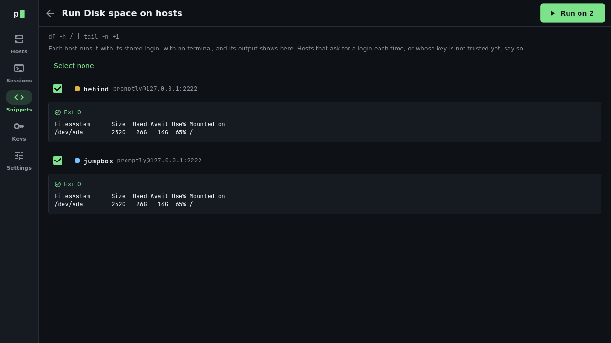
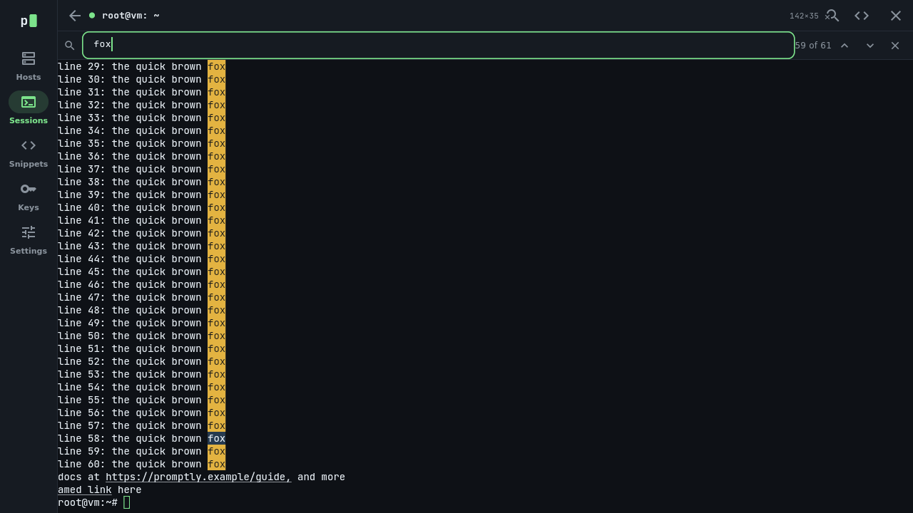
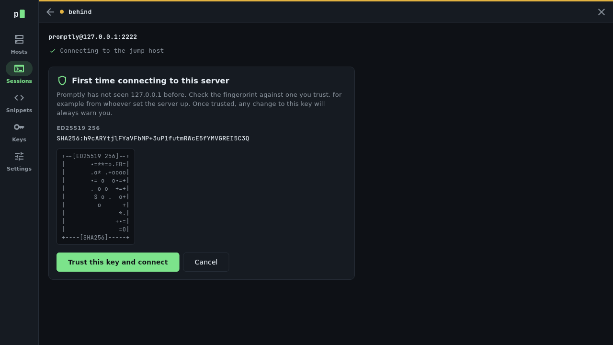
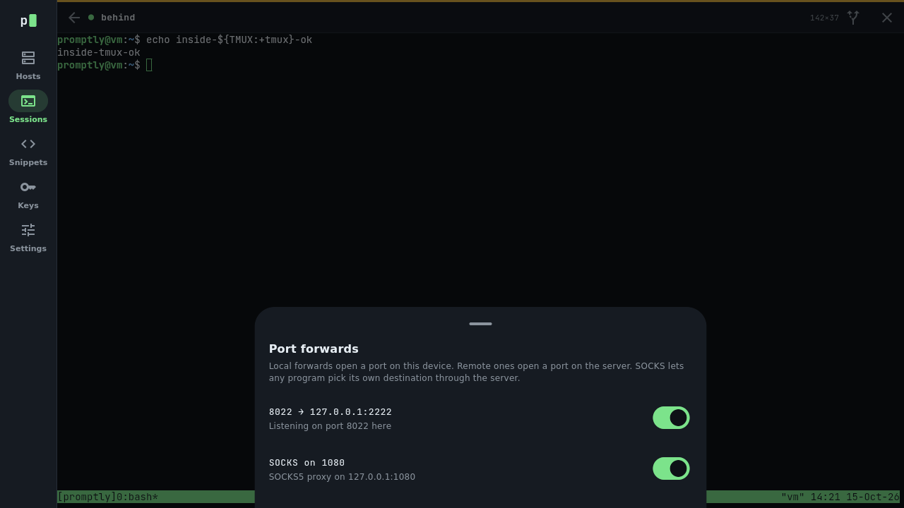
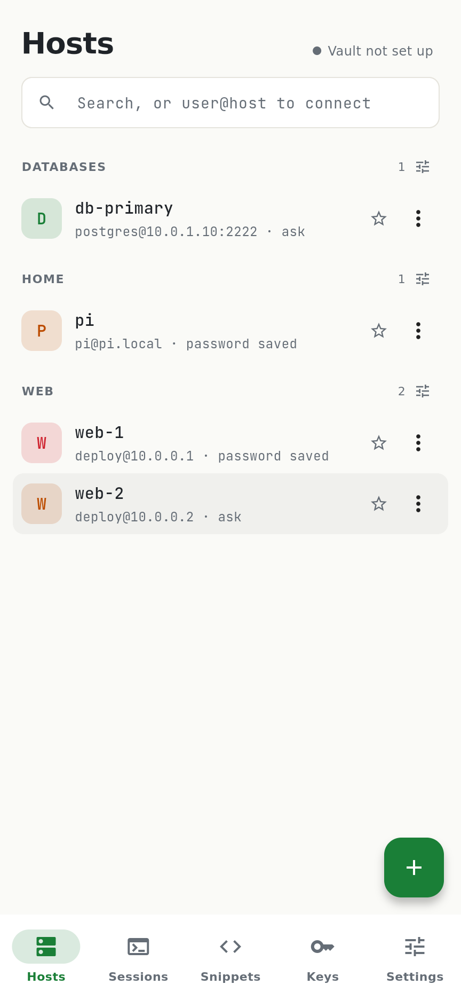

# Promptly

**Your terminal, everywhere. Your data, yours.**

Promptly is a fast, good-looking terminal and SSH client for your computer, tablet and phone. Your hosts, keys and snippets sync between all your devices through storage you already have, encrypted before they leave your hands. No account, no servers, no subscription. Free and open source.

  

  <a href="https://github.com/analogproblems/Promptly/releases/latest"><b>Download</b></a>
  &nbsp;·&nbsp;
  <a href="https://analogproblems.github.io/Promptly/guide/"><b>User guide</b></a>
  &nbsp;·&nbsp;
  <a href="CHANGELOG.md">What's new</a>

## Why Promptly

Most SSH apps that sync your setup between devices want a monthly subscription and a copy of your keys on their servers. Promptly keeps everything in an encrypted **vault**: a small folder of files that lives wherever you already keep files, such as a folder synced by Dropbox, iCloud Drive, Google Drive, OneDrive or Syncthing, or a server you own. Promptly encrypts it on your device first, so nobody along the way can read it.

| | Typical subscription SSH app | Promptly |
|---|---|---|
| Sync hosts and keys across devices | Paid plan, around $10 a month | Free, using storage you already have |
| Where your data lives | The company's servers | Your own folder or server |
| Who can read it | Encrypted in their format | Encrypted on your device, in an open, documented format |
| Leaving | Limited export | Full export and a command-line tool, any time |

## What it does

**A terminal that feels right.** Smooth scrolling, true colour, full-screen programs like vim, tmux and htop (mouse included), and fifteen themes with a live preview. Bring your own themes from iTerm2, Windows Terminal, Alacritty or base16. Search the scrollback, and Ctrl+click links to open them.

**Connecting made easy.** Save your servers once and connect with a tap. Sign in with a password, a key, a two-factor code, or nothing at all for servers like Tailscale SSH. Promptly checks each server's identity and warns you clearly if it changes. If the connection drops, it reconnects by itself with your screen still there.

**Built for real work.** Go through jump hosts, keep sessions alive in tmux across disconnects, forward ports with a switch for each one, and forward your SSH agent. Snippets save the commands you type all the time, with blanks Promptly asks you to fill in, and can run on a dozen servers at once.

**Files without a second app.** Browse a server's files over the connection you already have. Copy, rename, delete, change permissions, drag files between your computer and the server, and edit text files in place.

**A proper desktop workspace.** Tabs, split panes, a hosts panel you can drag servers from, a menu bar, and a command palette (Ctrl+Shift+P) that finds any host, snippet, theme or action from a few letters.

**At home on a phone.** The phone keyboard types exactly what you mean, with a bar above it for Esc, Tab, Ctrl, Alt, the arrows and the symbols a shell needs.

**Easy to move in.** Import your hosts and keys from `~/.ssh/config`, PuTTY keys, or a CSV such as the one Termius exports, groups and tags included.

**Private by design.** Promptly [collects nothing about you](docs/PRIVACY.md).

## A closer look

<table>
  <tr>
    <td width="50%"> The command palette: hosts, snippets, themes and actions in a few keystrokes.</td>
    <td width="50%"> Your files beside the server's. Drag to copy.</td>
  </tr>
  <tr>
    <td> Run a snippet on several servers and read what each one printed.</td>
    <td> Search the screen and scrollback.</td>
  </tr>
  <tr>
    <td> One vault, every device. You choose where it lives.</td>
    <td> Themes with a live preview, or import your own.</td>
  </tr>
  <tr>
    <td> Jump hosts, with every server's identity checked on the way.</td>
    <td> Port forwards you can switch on and off while connected.</td>
  </tr>
</table>

  
  &nbsp;
  

## Get Promptly

Download the latest version for your system from [GitHub Releases](https://github.com/analogproblems/Promptly/releases/latest).

| System | What to download |
|---|---|
| Windows | The zip. From the next release there is also an installer (`setup.exe`) that can update Promptly for you. |
| Mac | The `.dmg`, for Apple silicon and Intel Macs. |
| Linux | The `.deb` for Debian and Ubuntu, or the tarball for anything else. |
| Android | The `.apk`. Google Play is on the way. |

The Windows and Mac builds aren't signed with a paid certificate yet, so the first launch shows a warning you need to click past once. The [installing chapter](https://analogproblems.github.io/Promptly/guide/#2-installing-promptly) of the guide walks you through it. An iPhone version needs the App Store and comes later; [docs/DISTRIBUTION.md](docs/DISTRIBUTION.md) explains the plan.

## Learn more

The [user guide](https://analogproblems.github.io/Promptly/guide/) covers everything step by step: your first connection, keys, the desktop workspace, snippets, files, sync, every [keyboard shortcut](https://analogproblems.github.io/Promptly/guide/#17-keyboard-shortcuts) and [fixes for common problems](https://analogproblems.github.io/Promptly/guide/#20-troubleshooting).

Found a bug or have an idea? [Open an issue](https://github.com/analogproblems/Promptly/issues). For security problems, see [SECURITY.md](SECURITY.md).

## For developers

Promptly is a Flutter app on top of a Rust engine that does the terminal emulation (`alacritty_terminal`), SSH (`russh`), the vault and its encryption. On Ubuntu, `tools/setup.sh` then `make run` gets you going.

| Document | What it covers |
|---|---|
| [docs/DEVELOPMENT.md](docs/DEVELOPMENT.md) | Building, running and changing Promptly |
| [docs/DESIGN.md](docs/DESIGN.md) | Vision, principles, architecture and security |
| [docs/VAULT.md](docs/VAULT.md) | The vault format, encryption and sync |
| [docs/ROADMAP.md](docs/ROADMAP.md) | Milestones, what's built and what's next |

## Licence

MIT. Free, open source, no paid tier. See [LICENSE](LICENSE).
