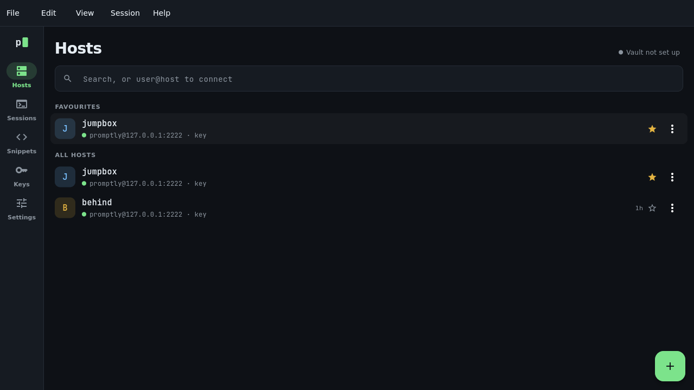
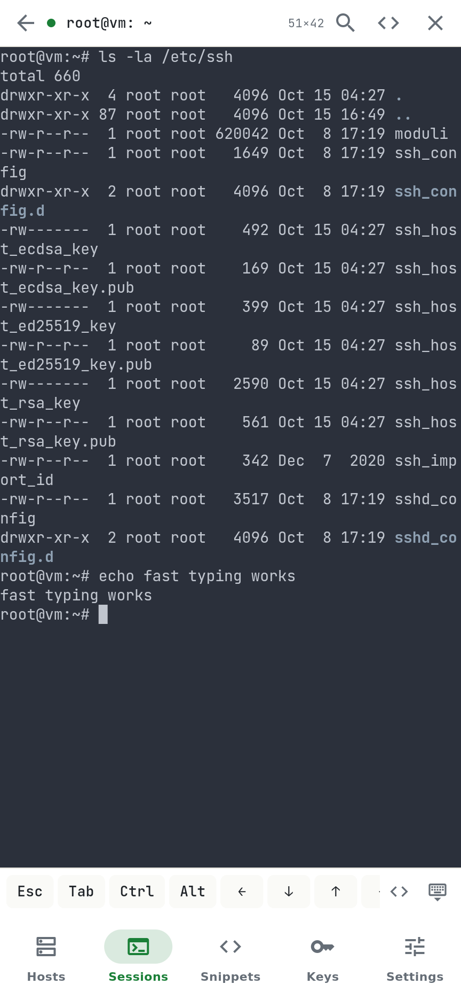
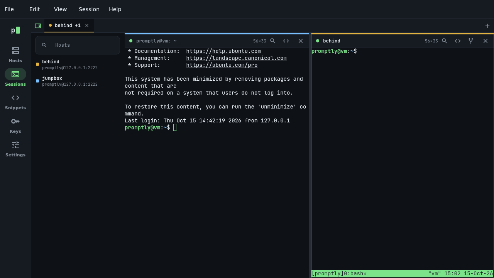
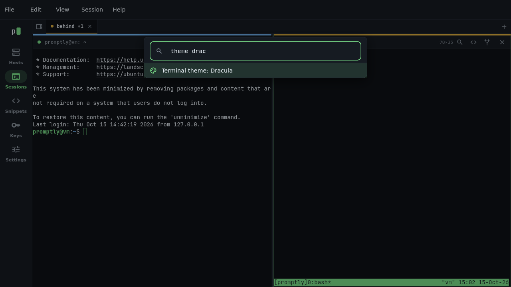
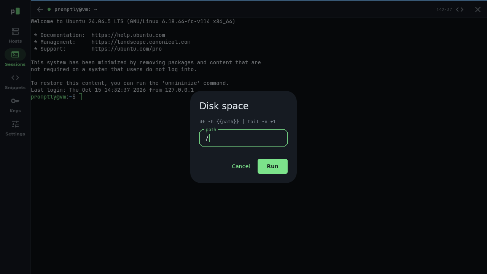
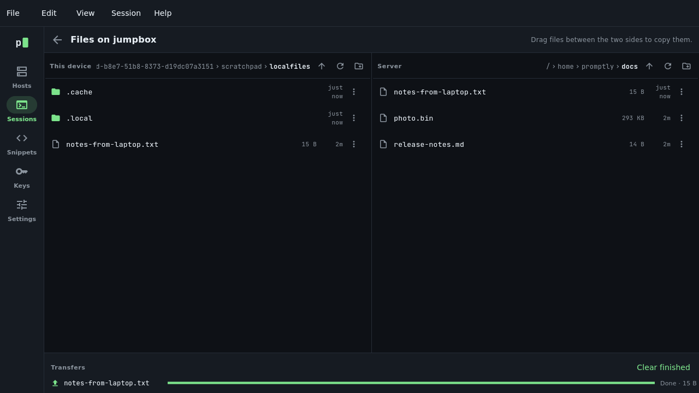

# Promptly User Guide

Promptly is a terminal and SSH client for your phone, tablet and computer. This guide explains how to install it, connect to your servers, and use every part of the app, from your first connection to syncing your setup across devices.

**Who this guide is for.** Anyone who uses SSH to reach servers, from a single home server to a fleet at work. You don't need to know how Promptly is built, but the guide assumes you know what a server, a username and a password are. Where SSH terms come up (keys, host keys, jump hosts, port forwards), the guide explains them in a sentence before using them.

**How to read it.** Chapters 1 to 4 get you connected. The rest are reference chapters you can dip into as you need them. Chapter 17 lists every keyboard shortcut, and chapter 20 covers common problems.

**Conventions.**

- Names of tabs, buttons and menu items appear in **bold**: tap **Hosts**, then **Save**.
- A path through menus uses a right angle bracket: **View › Go to tab › Tab 3**.
- Keys appear as you'd press them: Ctrl+Shift+P means hold Ctrl and Shift, then press P.
- Text you type, and things the computer prints, appear in `code style`.
- "Tap" also means "click" if you're using a mouse.

> **Note** boxes like this one add a detail worth knowing. **Important** boxes warn you about something you can't easily undo.

## Contents

1. [About Promptly](#1-about-promptly)
2. [Installing Promptly](#2-installing-promptly)
3. [Getting started](#3-getting-started)
4. [Finding your way around](#4-finding-your-way-around)
5. [Hosts](#5-hosts)
6. [Keys](#6-keys)
7. [Connecting to a server](#7-connecting-to-a-server)
8. [Working in the terminal](#8-working-in-the-terminal)
9. [The desktop workspace](#9-the-desktop-workspace)
10. [Snippets](#10-snippets)
11. [Files](#11-files)
12. [Port forwards](#12-port-forwards)
13. [More connection options](#13-more-connection-options)
14. [Sync](#14-sync)
15. [Themes and appearance](#15-themes-and-appearance)
16. [Settings reference](#16-settings-reference)
17. [Keyboard shortcuts](#17-keyboard-shortcuts)
18. [The promptly command-line tool](#18-the-promptly-command-line-tool)
19. [Privacy and security](#19-privacy-and-security)
20. [Troubleshooting](#20-troubleshooting)
21. [Getting help](#21-getting-help)

## 1. About Promptly

Promptly gives you a full terminal and an SSH client in one app. You save the servers you use (Promptly calls them **hosts**), connect with a tap, and get a terminal that handles colour, full-screen programs like `vim`, `htop` and `tmux`, and long scrollback.

What sets it apart is where your setup lives. Your hosts, keys, saved passwords and snippets are kept in an encrypted **vault**: a small folder of files that you put wherever you already keep files, such as a folder synced by Dropbox, iCloud Drive or Syncthing, or a server you own. Promptly encrypts the vault on your device before it goes anywhere. There is no Promptly account, no Promptly server and no subscription.

### What you can do with it

- Connect to servers with a password, an SSH key, your SSH agent, a two-factor prompt, or no credentials at all where the network vouches for you (for example Tailscale SSH).
- Keep connections alive through network drops, and reattach to a `tmux` session so long-running work survives.
- Reach servers behind a gateway with jump hosts, and reach services behind a server with port forwards.
- Save commands you type often as snippets, and run them in a session or on many servers at once.
- Browse, copy and edit files on a server over the connection you already have open.
- Work in tabs and split panes on a computer, with a command palette that does everything from the keyboard.
- Use the same hosts and keys on all your devices, synced for free through storage you already have.

### Platforms

| Platform | Status |
|---|---|
| Linux | Available. Tarball and `.deb` package. |
| Windows | Available. Zip file. |
| macOS | Available. Disk image (`.dmg`) for Apple silicon and Intel Macs. |
| Android | Available. APK file; Google Play is in testing. |
| iPhone and iPad | Planned. |

Promptly is free and open source under the MIT licence.

## 2. Installing Promptly

Download the file for your system from the [Releases page](https://github.com/analogproblems/Promptly/releases). Each release also includes a `SHA256SUMS` file, which you can use to check that your download arrived intact.

### Linux

- **Debian, Ubuntu and similar:** open the `.deb` file with your software installer, or run `sudo apt install ./promptly_*.deb` in the folder where you saved it.
- **Any other distribution:** unpack the tarball anywhere you like and run `./promptly` from inside it.

### Windows

The installer is the easiest choice, and the only one that can update itself.

1. Download `promptly-…-windows-x64-setup.exe` and run it.
2. Windows may show **Windows protected your PC**, because Promptly isn't signed with a paid certificate yet. Click **More info**, then **Run anyway**.
3. Follow the installer. It installs Promptly for your account only, so it doesn't need an administrator, and adds it to the Start menu. To uninstall, use **Settings › Apps** in Windows.

If you'd rather not install anything, download the zip instead, unzip it into a folder of your choice and run `promptly.exe`. Windows shows the same warning the first time.

If the zip copy reports that a `.dll` file is missing, install Microsoft's [Visual C++ Redistributable (x64)](https://learn.microsoft.com/cpp/windows/latest-supported-vc-redist) once and try again.

### macOS

1. Open the `.dmg` file and drag **Promptly** into **Applications**.
2. Open Promptly. macOS blocks the first launch, because the app isn't signed by Apple yet.
3. Open **System Settings › Privacy & Security**. Near the bottom you'll see a line about Promptly being blocked. Click **Open Anyway** and confirm with your password.

You only need to do this once. The **Open Anyway** button is shown for about an hour after the blocked launch, so if you don't see it, try opening Promptly again first.

### Android

1. Download the `.apk` file on your phone.
2. Open it. Android asks whether to allow installs from the app you opened it with (your browser or file manager). Allow it, then tap **Install**.

### Updating

Your hosts, keys and settings are kept when you update.

To see whether a new version is out, open **Settings › About Promptly** and tap **Check**. To have Promptly look once a day and tell you, turn on **Settings › Updates › Check for updates automatically** (it's off by default).

- **Windows, installed with the installer:** when a new version is out, tap **Update and restart**. Promptly downloads it, closes (along with any open sessions), installs it and opens again.
- **Everywhere else:** tap **Download** to open the release page, then install the new version the same way you installed the first one.

## 3. Getting started

### The welcome tour

The first time you open Promptly, a short three-page tour explains what the app does and where your data lives. Tap **Next** to move through it, or **Skip** at any time. The last page offers three ways to begin:

- **Add a host** opens the form for saving your first server.
- **Open a local shell** opens a terminal on your own computer (on Linux, Windows and macOS).
- **Set up sync** takes you to the vault setup (see [chapter 14](#14-sync)).

You can see the tour again later from **Settings › Help › Show the welcome tour again**.

### Your first connection in four steps

1. **Add a host.** Go to **Hosts** and tap the **+** button. Enter the server's address in **Hostname or IP** and your username in **User**. Under **Authentication**, choose **Password** and type your password, or leave it empty to be asked when you connect. Tap **Save**.
2. **Connect.** Tap the host in the list. Promptly opens a session and shows its progress as it connects.
3. **Check the server's identity.** The first time you connect to a server, Promptly shows the server's key fingerprint and asks whether to trust it. If you can, compare it with the fingerprint your server administrator gave you, then tap **Trust this key and connect**. ([Chapter 7](#7-connecting-to-a-server) explains why this matters.)
4. **Work.** You're in. Everything you type goes to the server.

Just want to try a server once without saving it? Type `user@host` (or `user@host:port`) into the search box at the top of **Hosts**, then tap **Connect** on the card that appears.

> **Note** For everyday use, an SSH key is safer and more convenient than a password. [Chapter 6](#6-keys) shows how to make one and put it on your server.

## 4. Finding your way around

Promptly is organised into five tabs:

| Tab | What it's for |
|---|---|
| **Hosts** | The servers you've saved. Tap one to connect. |
| **Sessions** | Your open connections and local shells. |
| **Snippets** | Saved commands. |
| **Keys** | Your SSH keys. |
| **Settings** | Appearance, sync, imports, help and information about the app. |

On a phone the tabs sit along the bottom of the screen. On a tablet or a computer they run down the left side.

### Phone and tablet layout

On a narrow screen the **Sessions** tab lists every open session with a live thumbnail of its screen, so you can glance at a long-running job without opening it. Tap a session to open it full screen, and tap the back arrow to return to the list. To go straight to the next session in the list, swipe sideways across the terminal with two fingers: to the left for the next one, to the right for the one before. A session keeps running while you move around the app.

### Desktop layout

On a computer with a window at least 900 pixels wide, the app gains a **menu bar** across the top (**File**, **Edit**, **View**, **Session** and **Help**), and the **Sessions** tab becomes a workspace with tabs, split panes and a hosts panel. [Chapter 9](#9-the-desktop-workspace) covers the workspace in detail. Make the window narrower and Promptly switches back to the simpler layout.

### The session bar

Each session has a slim bar along its top edge. From left to right it shows:

- A coloured dot: green when connected, amber while connecting, amber and pulsing while reconnecting, grey when not connected. Point at it (or use a screen reader) to hear which.
- For a [production host](#marking-a-production-host), a red bar above it with the host's label.
- The session's title, usually set by the server's shell (for example `deploy@web-1: ~`).
- The terminal's size in columns and rows, such as `120×40`.
- Buttons for **Search**, **Snippets**, **Files** (SSH sessions only) and **Port forwards** (hosts that have some), and a **Close** button.

## 5. Hosts

A host is a saved server: where it is, who you log in as, and how. Hosts are listed on the **Hosts** tab.

### The hosts list

Each row shows the host's label, its address, how it logs in (`key`, `password`, `password saved`, `agent`, `ask` or `no login`), and when you last connected. Each host has a coloured tile with its first letter, which also marks its sessions, so you always know which server you're typing into.

Above the full list you may see two shortcut sections:

- **Favourites:** hosts you've starred. Tap the star on any row to add or remove it.
- **Recent:** up to five hosts you've connected to in the last 30 days. This appears once you have four or more hosts.

If you use groups, the full list is divided into one section per group, with ungrouped hosts under **Other**.

**To find a host,** type in the search box. It matches labels, addresses, usernames, tags and notes.

**To connect,** tap the host's row.

**To edit, favourite or delete a host,** open the **⋮** menu at the end of its row.

The small indicator at the top right of the list shows your sync status. Tap it to open the sync settings.



### Adding a host

Tap the **+** button on the **Hosts** tab. The form has six sections. Only the address and user are required; everything else is optional. If the host is in a group, the form shows what the group fills in for the fields you leave to it.

**Basics**

| Field | What to enter |
|---|---|
| **Label** | A short name for the list, such as `web-1`. If you leave it blank, the address is used. |
| **Hostname or IP** | The server's address, such as `web-1.example.com` or `10.0.0.11`. |
| **Port** | The SSH port. Usually `22`. If the host's group sets a port, leaving this at `22` (or blank) uses the group's. |
| **User** | The account you log in as. If the host is in a group that sets a default user, you can leave this blank. |

**Authentication.** Choose how Promptly proves who you are:

| Method | When to use it |
|---|---|
| **Password** | The server asks for a password. Type it to save it, and keep **Remember the password on this device** on; or leave the field empty to be asked each time you connect. |
| **Key** | You've put one of your SSH keys on the server. Pick the key from the list. If the list is empty, make a key on the **Keys** tab first. |
| **Agent** | Your keys live in an SSH agent on this computer (for example `ssh-agent` on Linux or macOS, or the OpenSSH agent or Pageant on Windows). |
| **Ask each time** | The server decides what to ask for, such as a password, a two-factor code, or both, and Promptly shows you its questions. If the server needs nothing, you go straight in. |
| **None** | The server checks who you are some other way, so it needs no password or key. Tailscale SSH works like this. |

> **Note** Whatever you choose, Promptly first checks whether the server needs a login at all. If it doesn't, you're connected without any prompt.

Some servers only ask for the password through their own login prompt (PAM). A host set to **Password** works with them too: Promptly answers the server's password question with the saved password, or asks you for it. Anything else the server asks, such as a two-factor code, is shown to you.

**To check the settings before saving,** tap **Test connection**. Promptly runs the real connection steps with the form as it stands, asks any questions it needs to (a new host key, a password), then hangs up. Nothing is saved, and the startup command, persistent session and port forwards are left out of the test.

**Organise**

- **Group:** put the host in a group, or tap **New group** to make one. See [Groups](#groups) below.
- **Colour:** pick the colour used for the host's tile and its sessions.
- **Favourite:** show the host in the **Favourites** section.
- **Tags:** words to find the host by, separated by commas, such as `web, eu-west`.
- **Mark as production:** see [Marking a production host](#marking-a-production-host) below.
- **Keep on this device only:** if you use sync, the host and its saved password stay on this device and never go into the vault. Turning it on for a host that already syncs removes it from your other devices; it stays here. Turn it off to sync it again. See [Keeping things on one device](#keeping-things-on-one-device).

**Connection.** Jump host, persistent session, agent forwarding, startup command, environment variables and keep-alive. These are explained in [chapter 13](#13-more-connection-options).

**Port forwards.** Tunnels that start with the session. See [chapter 12](#12-port-forwards).

**Notes.** Anything worth remembering about the server.

Tap **Save** when you're done.

### Marking a production host

Turn on **Mark as production** in the host's **Organise** section, and optionally type a **Label on the bar**, such as `Live payments`. Every session to that host then has a red bar across the top with the label in capitals (or **PRODUCTION** if you leave the label empty), and on a computer its tab carries the label too. The words are there as well as the colour, so the warning doesn't depend on seeing red.

### Editing and deleting a host

Open the **⋮** menu on the host's row and choose **Edit**. To delete a host, choose **Delete** from the same menu, or tap **Delete host** at the bottom of the edit form.

Deleting a host also removes its saved password. Keys are kept, because other hosts may use them.

### Groups

Groups keep a long list tidy (**Production**, **Homelab**, **Clients**) and save typing, because a group can supply defaults to its hosts.

**To create a group,** tap **New group** in a host's **Organise** section.

**To edit a group,** tap the **Edit group** button (the sliders icon) next to the group's name in the hosts list. There you can:

- Rename the group and choose its colour.
- Set a default **User** for hosts that leave **User** blank.
- Set a default **Port** for hosts left on port 22.
- Set a default **Key** for hosts set to **Agent** or **Ask each time**.
- Set a default **Jump host** for hosts that don't have one of their own.
- Delete the group. Its hosts stay, listed under **Other**.

A group made inside another group (for example by importing `Work/Databases` from a CSV file) takes the outer group's defaults for anything it leaves blank. SFTP sync uses the group's defaults and jump hosts too, the same way a terminal session does.

### Checking which hosts are up

Turn on **Settings › Hosts › Show which hosts are up** to see a dot beside each host: green when its SSH port answers, with the response time, and red when it doesn't. Promptly checks once a minute while the setting is on, by briefly knocking on each host's port from your device. Nothing else is sent.

### Importing hosts

You don't have to type in every server by hand.

**From your SSH config (Linux, Windows and macOS).** If you already use the `ssh` command, your hosts are probably in `~/.ssh/config`. Go to **Settings › Hosts › Import from ~/.ssh/config** (or use the button on an empty hosts list). Promptly lists the hosts it found; untick any you don't want and tap **Import**. Each host comes in with its user, port and jump host. A key named by `IdentityFile` is imported too; hosts without one are set to use your SSH agent. Hosts you've already imported are greyed out.

**From a CSV file.** Go to **Settings › Hosts › Import from a CSV file** and choose the file. This reads the CSV that Termius exports, or any CSV with a `Hostname` column. Hosts come in with their user, port, group and tags. A password in the file is saved with its host; a host without one asks for it when you connect.

## 6. Keys

An SSH key is a pair of matching files: a **private key** that you keep, and a **public key** that you put on each server. When you connect, Promptly proves it holds the private key without ever sending it. Keys are safer than passwords and save you typing.

Your keys are listed on the **Keys** tab, each with its type and fingerprint. Private keys are kept encrypted. If you use sync, they also go to your other devices, encrypted in the vault, unless you keep a key on this device only.

### Generating a key

1. On **Keys**, tap **Generate**.
2. Give the key a name, such as `laptop` or `work`.
3. Choose a type. **ed25519** is recommended. Choose **ECDSA P-256** only if a server requires it, or **RSA 4096** for very old servers (it takes a few seconds to generate).
4. If you use sync and want this key on this device only, turn on **Keep on this device only**. Keys sync by default.
5. Tap **Generate**.

### Putting your public key on a server

The quick way, for a server you've saved as a host:

1. On **Keys**, open the key's **⋮** menu and choose **Install on a host…**.
2. Pick the host. Promptly logs in the way the host is set up to. If the host has no saved password or key, type its password.
3. Tap **Install**. Promptly adds the key to `~/.ssh/authorized_keys` on the server, making the `~/.ssh` folder and the file if they're missing, and says whether it added the key or the server had it already. Running it twice never adds the key twice.
4. Edit the host, set **Authentication** to **Key**, pick the key, and tap **Save**.

From then on the host logs in with the key.

By hand, for any server:

1. On **Keys**, open the key's **⋮** menu and choose **Copy public key**. **Show public key as QR code** shows the same line as a QR code, for another device's camera.
2. Connect to the server with your password.
3. Add the copied line to the file `~/.ssh/authorized_keys` on the server. For example, type `echo '` then paste, then type `' >> ~/.ssh/authorized_keys` and press Enter.
4. Edit the host as in step 4 above.

### Importing a key you already have

1. On **Keys**, tap **Import**.
2. Give the key a name.
3. Paste the private key into **Private key**, or tap **Choose a file** to pick it. Promptly reads OpenSSH keys (such as `id_ed25519`), PEM files and PuTTY `.ppk` files. PuTTY keys are converted to the OpenSSH format.
4. If the key is protected by a passphrase, type it in **Passphrase**. **Remember passphrase** (on unless you turn it off) saves it with the key, so you aren't asked for it when you connect.
5. To keep it on this device only, turn on **Keep on this device only**.
6. Tap **Import**.

### Keys with a passphrase

When a key with a passphrase is used and its passphrase isn't saved, Promptly asks for it as it connects. Leave **Remember passphrase** on to save it with the key, encrypted like your other secrets. It then goes wherever the key goes: into the vault with a key that syncs, or nowhere but this device with a key kept on this device only. A saved passphrase is used for connecting, reconnecting, running snippets on many hosts and syncing with a vault on your own server. With it off, the session still uses the passphrase to reconnect, but a new connection asks again.

Keys with a saved passphrase show **passphrase saved** under their name. To stop saving it, open the key's **⋮** menu and choose **Forget saved passphrase**; Promptly asks for it the next time you connect.

### Exporting a private key

Open the key's **⋮** menu and choose **Export private key…**. Anyone who gets the copy can log in wherever the key works, so keep it somewhere safe and delete copies you no longer need.

1. To lock the copy with a passphrase, turn on **Lock the copy with a new passphrase** and type the new passphrase twice. If the key has a passphrase that isn't saved, type it too. With this off, the copy is the key exactly as stored, with its own passphrase if it has one.
2. Tick **I understand that anyone with the copy can use this key**.
3. Tap **Copy** to copy it, or, on a computer, **Save to a file…**. On Linux and macOS the saved file can be read only by you.

### Keeping a key on one device

Open the key's **⋮** menu and choose **Keep on this device only**. The key leaves the vault and your other devices, and stays here. **Sync with the vault** in the same menu puts it back. Keys kept on one device show **this device only** under their name.

### Deleting a key

Open the key's **⋮** menu and choose **Delete**. Promptly tells you if any hosts use the key; they'll need another way to log in. Deleting a key removes the private key (and its saved passphrase) from this device, and from your other devices too if you use sync. This can't be undone.

> **Important** Before deleting a key you made in Promptly, make sure you can still reach your servers another way. Without the private key, a server that only accepts that key will not let you in.

## 7. Connecting to a server

Tap a host to connect. While Promptly connects, the session shows each step as it happens (connecting to a jump host if there is one, resolving the address, connecting, verifying the host key, authenticating, opening the shell). Tap **Cancel** to stop.

### Verifying the server's identity

Every SSH server has its own **host key**, which proves the server is the one you meant to reach. The first time you connect, Promptly shows you the key's fingerprint (a long string of letters and numbers) and a small picture made from it, and asks whether to trust it.

- **First time connecting to this server.** If you have the fingerprint from a trusted source, such as your server administrator or your hosting provider's console, compare them. If they match, tap **Trust this key and connect**. Promptly remembers the key and checks it on every later connection.
- **This server's key has changed.** Promptly will always stop and warn you, on a page of its own, if a server's key is different from the one you trusted. That can mean the server was reinstalled, or that something between you and the server is pretending to be it. **Disconnect** is the main button. If you know why the key changed, check the new fingerprint with whoever runs the server, then tap **I know why it changed**, tick the box to say the fingerprint matches, and tap **Trust the new key and connect**. The new key replaces the old one on all your devices, so you're only asked once.

Promptly also reads the trusted keys in your own `~/.ssh/known_hosts` on a desktop, including hashed entries and `@revoked` lines. A key you revoke there is never trusted, and a server that suddenly offers a different kind of key counts as a changed key, not a new server.

If you use sync, a server you trust on one device is trusted on all of them.


### Answering login prompts

Depending on the host's authentication method, Promptly may ask you for a password, a key's passphrase, or show the server's own questions (a two-factor code, for example). Type your answer and tap **Connect** or **Continue**. Tap the eye icon to show a password as you type it. For a key's passphrase, **Remember passphrase** saves it with the key (see [Keys with a passphrase](#keys-with-a-passphrase)).

### If the connection fails

If Promptly can't connect, the session says what went wrong in plain words, such as **Couldn't find web-1.example** or **Nothing is answering on port 22**, and what to try next. Tap **Details** for the technical reason, which helps whoever runs the server. If the server refused the login, the advice says which ways in it accepts (only keys, for example). Tap **Try again** to retry, or **Close** to give up. [Chapter 20](#20-troubleshooting) covers the common causes.

### Dropped connections

Networks drop, laptops sleep and phones change from Wi-Fi to mobile data. When an SSH connection drops, Promptly keeps the session's screen and reconnects by itself, waiting a little longer between each try (1, 2, 4, 8, 16, then 30 seconds), for up to ten tries. A bar over the session shows what's happening, and the session's dot pulses amber. Tap **Stop** to stop trying.

If reconnecting stops or runs out of tries, the session stays on screen with its output, marked as ended. Tap **Reconnect** to try again, or **Close** to close it. You can also reconnect from **Session › Reconnect** on a computer.

A reconnect starts a new shell on the server; programs you were running in the old one have ended. To keep programs running through a drop, turn on **Persistent session** for the host (see [chapter 13](#13-more-connection-options)).

### When you leave the app on a phone

On Android, open sessions keep running while you use other apps or the screen is off. While at least one is open, Promptly shows a notification such as **Promptly: 2 sessions open**; tap it to come back. The first time, Android 13 and later ask whether Promptly may show notifications. If you say no, the sessions still keep running, but the notification is hidden. Swiping Promptly away from your recent apps closes its sessions.

If a connection drops while you're away anyway (the phone lost its signal, or the system stopped the app's network to save battery), Promptly reconnects it as soon as you come back, without waiting for the next try. With **Persistent session** on, you're back in the same `tmux` session with nothing lost. Sessions you stopped with **Stop** stay ended.

### Local shells

On Linux, Windows and macOS, Promptly can also open a terminal on your own computer. Tap **Local shell** on the **Sessions** tab, or choose **File › New local shell**. When the shell exits, tap **New shell** to start another.

### Closing a session

Tap the **×** at the right of the session bar, or the **×** on its card in the **Sessions** list. Closing a session disconnects it.

## 8. Working in the terminal

### Typing

Everything you type goes to the program in the terminal. Promptly keeps only a few key combinations for itself, all using Shift or Alt, so that shortcuts like Ctrl+D, Ctrl+W, Ctrl+T, Ctrl+B and Ctrl+K reach your shell, editor or `tmux` as they should. The full list is in [chapter 17](#17-keyboard-shortcuts).

### Selecting and copying text

With a mouse:

- **Drag** to select text. Dragging past the top or bottom edge scrolls to select more.
- **Double-click** to select a word, **triple-click** to select a line.
- **Ctrl+Shift+C** copies the selection, and **Ctrl+Shift+V** pastes. On a Mac, Cmd+C and Cmd+V also work.
- **Right-click** for a menu with **Copy** and **Paste**.
- **Middle-click** pastes.
- When what you paste has more than one line, Promptly shows it first with a line count, because each line runs as a command. Choose **Paste**, **Paste without final newline** (so the last line waits for you to press Enter) or **Cancel**. Turn this off with **Show text before pasting several lines** in Settings, Terminal.

Typing clears the selection, as in other terminals.

### Programs that use the mouse

Some full-screen programs, such as `vim` with mouse support on, `tmux` and `htop`, ask for the mouse. In those programs, clicks, drags and the scroll wheel go to the program. **Hold Shift** to select text or scroll the terminal yourself instead. On a touch screen, a tap is a click at the spot you tap, so you can move the cursor in `vim`, pick a `tmux` pane or a process in `htop`.

### Scrolling back

Scroll with the mouse wheel or trackpad, or press Shift+Page Up and Shift+Page Down. Typing anything jumps back to the bottom.

Each session keeps the last 10,000 lines. For more (up to 100,000) or fewer, change **Lines to keep for scrolling back** in Settings, Terminal. More lines use more memory, and the change applies to sessions you open after making it.

### Finding text

Tap the magnifier in the session bar, or press Ctrl+Shift+F. Type what you're looking for: every match in the screen and the scrollback is highlighted, and the count is shown. Press Enter to move to the previous (older) match and Shift+Enter for the next one, or use the arrow buttons. The current match is selected, ready to copy. Press Esc to close the search bar.

### Links

Web addresses in the output are faintly underlined. **Ctrl+click** a link to open it in your browser (Cmd+click on a Mac), or **right-click** it and choose **Open link** or **Copy link**.

File paths that start with `/` or `~/` (such as `/var/log/syslog`) and IP addresses (such as `10.0.0.1` or `10.0.0.1:22`) are found too. They aren't underlined, so the screen stays calm, but the pointer changes over them. **Ctrl+click** one to copy it, or **right-click** it and choose **Copy path** or **Copy address**. Version numbers such as `1.2.3` are left alone.

On a touch screen, tap a link, path or address for the same menu: **Open link** and **Copy link**, or **Copy path** or **Copy address**. This works in programs that use the mouse, too.

### Text size

Press Ctrl+= for bigger text, Ctrl+- for smaller, and Ctrl+0 to go back to the normal size. On a touch screen, pinch the terminal with two fingers: spread them for bigger text, close them for smaller. These are also in the **View** menu. The terminal resizes to fit, and the server is told the new size. Promptly remembers the size, so new sessions open at it. You can also pick it with **Text size** in Settings, Terminal, which changes open sessions too.

### The bell

Programs ring the bell to get your attention, for example when you press Tab and there is nothing to complete. Promptly flashes the terminal briefly; with reduced motion turned on in your device's settings, a thin outline appears instead of a flash. Under **Bell** in Settings, Terminal, you can choose **Vibrate** instead (phones and tablets; elsewhere the screen still flashes) or **Do nothing**.

### Letting programs set your clipboard

Some programs, such as `tmux` and `vim`, can copy text to your clipboard directly, even over SSH. This is off by default, so no remote program can change your clipboard. To allow it, turn on **Settings › Terminal › Let programs copy to the clipboard**.

### On a phone or tablet

Tap the terminal to bring up the keyboard. Promptly takes what you type exactly as the keyboard sends it, including autocorrected words and emoji.

With your fingers on the terminal:

- **Tap** a link, path or address to open or copy it. In a program that uses the mouse, a tap is a click.
- **Double tap** a word to select it, then choose **Copy** from the menu that appears.
- **Pinch** to change the text size. Promptly remembers it for new sessions.
- **Swipe sideways with two fingers** to go to the next or previous session.

Above the keyboard is a bar with the keys a phone keyboard lacks. Swipe it sideways to see them all:

| Key | What it does |
|---|---|
| **Esc**, **Tab** | Sends the key. |
| **Ctrl**, **Alt** | Sticky: tap it, then the next key you type is sent with it. For example, tap **Ctrl** then type `c` to send Ctrl+C. To keep it held for several keys, tap it twice quickly or press and hold it: it shows a padlock and stays on until you tap it again. |
| **← ↓ ↑ →** | Arrow keys. With **Ctrl** or **Alt** held they send the combination programs expect, so Ctrl+← jumps back a word in most shells. To move further, hold an arrow key for a moment, then slide your finger: the cursor follows it in any direction, like a trackpad. |
| **- / \| ~ :** | Characters the shell uses often. |
| **Home**, **End**, **PgUp**, **PgDn**, **Del** | Sends the key. |




At the right end of the bar, the **‹›** button opens your snippets, and the keyboard button hides the keyboard. Tap the terminal to bring it back.

**To choose the keys on the bar,** go to **Settings › Terminal › Keyboard bar**. Drag a key by its handle to move it, tap **−** to take it off the bar, and tap a key under **More keys** to add it: there are F1 to F12, Insert and more symbols such as `_`, `\`, `*`, `&` and brackets. **Use the usual keys** puts the bar back as it came.

> **Note** Selecting more than one word and scrolling back with your finger aren't available yet on touch screens. To find earlier output, use **Search**.

## 9. The desktop workspace

On a computer, with the window at least 900 pixels wide, the **Sessions** tab becomes a workspace for working on several servers at once.

### Tabs

Tabs run across the top of the workspace. Each tab holds one or more panes; its title shows the focused session, with a count when there are more (`web-1 +1`).

- **New tab:** Ctrl+Shift+T, or the **+** at the right of the tab strip.
- **Switch tabs:** click a tab, press Ctrl+Tab and Ctrl+Shift+Tab, or press Alt+1 to Alt+9 for a particular tab. **View › Go to tab** lists the tabs by number.
- **Close a tab:** click the **×** on the tab. This closes every session in it.

### Split panes

Split the focused pane to see two sessions side by side or one above the other.

- **Split right:** Ctrl+Shift+D.
- **Split down:** Ctrl+Shift+E.
- **Move between panes:** Alt+Arrow keys, or click a pane.
- **Resize:** drag the divider between panes.
- **Close a pane:** Ctrl+Shift+W. The tab closes with its last pane.

A new pane starts empty, offering a searchable list of your hosts and a **Local shell** button. Pick a host, or drag one in from the hosts panel.



### The hosts panel

Press Ctrl+Shift+B, or click the panel button at the left of the tab strip, to show your hosts beside the panes. **Click** a host to connect in the focused pane if it's empty, or in a new tab if it isn't, or **drag** it onto any pane.

### The command palette

Press Ctrl+Shift+P to open the command palette, then type a few letters of what you want and press Enter. It can:

- Connect to any host (`Connect to web-1`).
- Run any snippet in the focused session.
- Open a new tab, split, close a pane, or show the hosts panel.
- Find in the session, open its files or port forwards, or reconnect it.
- Go to any tab of the app, add a host or a snippet, or open sync settings.
- Switch the app's look or the terminal theme.

You can type several words in any order; the palette shows items that contain all of them.



### The menu bar

| Menu | Items |
|---|---|
| **File** | New tab, New local shell, Add host, Close pane, Quit |
| **Edit** | Copy, Paste, Find in session, Command palette |
| **View** | Split right, Split down, Focus pane left, right, up or down, Next tab, Previous tab, Go to tab, Hosts panel, Bigger text, Smaller text, Reset text size, Terminal themes |
| **Session** | Reconnect, Port forwards, Snippets, Files, Close session |
| **Help** | Help, Settings, About Promptly |

Items in the **Session** menu act on the focused session.

## 10. Snippets

A snippet is a saved command: something you type often, such as checking disk space, tailing a log, or restarting a service. Snippets are on the **Snippets** tab.

### Creating a snippet

1. On **Snippets**, tap the **+** button.
2. Enter a **Label**, such as `Disk space`. If you leave it blank, the command's first line is used.
3. Enter the **Command**. It can be several lines.
4. Optionally add **Tags**, separated by commas, to help you find it later.
5. Tap **Save**.

### Variables

For the parts of a command that change, write a name in double curly braces. For example:

```
df -h {{path}}
```

As you type, a **Variables** section appears under the command, with one entry for each name. For each one you can set a **Default** value and a **Prompt** (the question to ask, such as `Which folder?`). When the snippet runs, Promptly asks for each variable, pre-filled with its default.



### Running a snippet in a session

There are several ways to run a snippet in a session:

- In a session, tap the **‹›** button in the session bar (or on the phone keyboard bar), then tap the snippet.
- On a computer, press Ctrl+Shift+P and type the snippet's name.
- On the **Snippets** tab, tap the snippet. If more than one session is open, Promptly asks which one.

Promptly fills in the variables, types the command into the session and presses Enter.

### Running a snippet on many hosts

To run the same command on several servers and compare the results:

1. On **Snippets**, open the snippet's **⋮** menu and choose **Run on hosts**.
2. Tick the hosts to run it on, or tap **Select all**.
3. Tap **Run on** (the button shows how many hosts you picked), and fill in any variables once for all of them.

Each host runs the command with its saved login, without opening a terminal, and shows what it printed and its exit code. A command still running after 60 seconds is stopped, and you see what it printed by then.

A host can only take part if it can log in without you: with a saved password, a key, the agent, or no login at all. Promptly also needs to have seen its host key before, so connect to a new server once in the terminal first. Hosts that can't take part say why.

### Editing and deleting snippets

Open the snippet's **⋮** menu and choose **Edit** or **Delete**. If you use sync, a deleted snippet is removed from every device.

## 11. Files

You can browse and manage the files on a server over the SSH connection you already have open, without a separate login.

**To open the file browser,** tap **Files** (the folder icon) in the session bar, or choose **Session › Files** on a computer. The session must be connected. Tap the back arrow to return to the session.

### Browsing

The browser opens in your home folder on the server. Tap a folder to open it. The path above the list is clickable, so you can jump back to any folder in it. Use the buttons beside the path to go **Up** a folder, **Refresh** the listing, or make a **New folder**.

Each item's **⋮** menu offers:

| Action | What it does |
|---|---|
| **Open** | Opens a folder. |
| **Edit** | Opens a text file in the editor. |
| **Download to this device** | Saves a copy of the file on your phone or computer (see below). |
| **Upload to the server** | Copies a file from your computer to the server (on a computer, with two panes). |
| **Open in another app** | Fetches the file and opens it in the app your device uses for that kind of file. On a phone, pick the app from the share sheet. |
| **Rename** | Renames the file or folder. |
| **Permissions** | Sets who can read, write and run it (see below). |
| **Delete** | Deletes it. Deleting a folder deletes everything inside it. This can't be undone. |

### Copying files between your computer and the server

On a computer, the file browser shows two panes: your own files on the left and the server's on the right. **Drag** a file from one side to the other to copy it into the folder open there, or use **Download to this device** or **Upload to the server** from its **⋮** menu. A **Transfers** bar at the bottom shows each copy's progress; tap **✕** beside one to stop it, or **Clear finished** to tidy the list. When you stop a copy, Promptly removes the part it had copied, and tells you if it can't. Until that is done, Promptly won't start another copy to the same place. If you stop a copy at the very moment it opens the file it writes to, that file can be left empty: Promptly leaves it alone rather than risk removing a file that was there before.



Folders can't be copied in one go yet. Open the folder and copy its files.

### Copying files on a phone

On a phone (or a narrow window) the browser shows only the server's files.

- **To upload,** open the server folder you want the files in and tap **Upload files from this device** (the upload icon beside the path). Pick one or more files. If the folder already has a file with the same name, Promptly asks before replacing it.
- **To download,** choose **Download to this device** from a file's **⋮** menu. When the file has arrived, the share sheet opens: choose **Save to Files** (iPhone and iPad) or the app you want to keep it in, such as Files or Drive. In a narrow window on a computer, you're asked where to save it instead.
- **To open a file in another app,** such as a PDF viewer or a photo editor, choose **Open in another app**.

The **Transfers** bar shows each copy's progress. Tap **✕** to stop one.

### Setting permissions

Choose **Permissions** from a file's menu. Tick **Read**, **Write** and **Run** for the **Owner**, the **Group** and **Others**. The number form (such as `644`) is shown as you go. Tap **Apply**.

### Editing a text file

Choose **Edit** from a file's menu. The file opens in a plain text editor. Press Ctrl+S or tap **Save** to write it back in place. If you close the editor with unsaved changes, Promptly asks before discarding them. Files larger than 2 MB, and files that aren't text, can't be edited here.

## 12. Port forwards

A port forward is a tunnel through your SSH connection. Promptly supports three kinds:

| Kind | What it does | Example |
|---|---|---|
| **Local** | Opens a port on your device that leads to a service the server can reach. | Reach a database that only listens on the server: forward port `5432` here to `localhost:5432` as the server sees it, then connect your database tool to `localhost:5432`. |
| **Remote** | Opens a port on the server that leads back to a service your device can reach. | Show a web app running on your laptop to the server: forward server port `8080` to `localhost:3000` as your device sees it. |
| **SOCKS** | Runs a SOCKS5 proxy on your device that sends each connection through the server. | Point your browser's proxy setting at `127.0.0.1:1080` to browse as if you were on the server's network. |

### Setting up a forward

1. Edit the host and go to **Port forwards**.
2. Tap **Add forward** and choose **Local**, **Remote** or **SOCKS**.
3. Fill in the port to open (**Port here** or **Server port**), and for Local and Remote forwards, where it should lead (a host and port).
4. Turn on **Start when the host connects** to start the forward with every session.
5. Tap **Save**.

### Turning forwards on and off

While connected, tap the **Port forwards** button in the session bar (or choose **Session › Port forwards**). Each forward has a switch, and shows where it's listening or why it couldn't start.

## 13. More connection options

These options are in the **Connection** section of the host form.

### Jump host

Some servers can only be reached through another server, often called a jump host or bastion. Set **Jump host** to the saved host to go through first. If the host's group sets a jump host, the list shows it as the group's, and it's used unless you pick another. Promptly connects to the jump host, then on to the server, with each one using its own login. A jump host can have a jump host of its own, so you can chain as many as you need. Promptly checks the host key of every server along the way.

### Persistent session

Turn on **Persistent session** to have Promptly attach to a `tmux` session on the server instead of starting a plain shell. Your programs then keep running on the server when the connection drops, your laptop sleeps, or your phone locks, and when Promptly reconnects you're back where you left off. The server needs `tmux` installed.

### Agent forwarding

Turn on **Agent forwarding** to let programs on the server use the SSH agent on your device, for example to `git pull` from a private repository using your own key. Only turn this on for servers you trust: while you're connected, anyone with administrator access to that server could use your agent.

### Startup command

A command typed into the shell as soon as the session opens, such as `cd /srv/app && git status`. With *Persistent session* on, it is typed only when the tmux session is first made, so reconnecting never types it into whatever is running there.

### Environment

Environment variables to send to the server, one `NAME=value` per line. The server only accepts the names its SSH configuration allows (its `AcceptEnv` setting), so some may be ignored.

### Keep-alive

How often, in seconds, Promptly pings the server so an idle connection isn't dropped by a router or firewall. The default is 30. Set it to 0 to turn keep-alives off; an idle connection may then be dropped by the network, and Promptly only notices when you next type.

## 14. Sync

Sync keeps the same hosts, groups, keys, saved passwords, snippets, trusted host keys and imported themes on all your devices. It's free, because it uses storage you already have.

### How it works

Promptly keeps your data in a **vault**: a small folder of encrypted files, usually under 100 KB. Everything is encrypted on your device with a key protected by your **passphrase** before it's written to the vault, so whoever stores the folder (Dropbox, Google, your own server) sees only scrambled files. Each device writes only to its own part of the vault, so devices never overwrite each other's work. If two devices change the same thing while offline, the most recent change wins.

After you change something, Promptly syncs within a few seconds, and keeps checking for changes from your other devices while it's open. It also syncs when you come back to the app, and you can pull the **Hosts** list (or the sync screen) down to sync straight away. A host added on one computer usually appears on another within half a minute. Promptly doesn't sync while it's closed or in the background on a phone.

### Keeping things on one device

A host or key with **Keep on this device only** turned on never goes into the vault, and neither does the password or private key that goes with it. Use it for something that should never leave this device, such as a key for a server only this computer may reach.

Turning it on for something that already syncs removes it from your other devices, and from the vault, the next time this device syncs. Nothing is deleted here. Changes your other devices make to it are ignored on this one. Turning it off sends it to the vault again in full.

### Choosing where the vault lives

Go to **Settings › Sync** and tap **Set up** (or tap the sync indicator on the **Hosts** tab). You have three choices:

- **A folder on this computer.** Pick a folder that a sync service already mirrors between your devices: Syncthing, Dropbox, iCloud Drive, Google Drive, OneDrive, or any other. The sync service moves the files; Promptly does the encryption.
- **Your own server.** Keep the vault in a folder on a server you've already saved in Promptly, reached over SFTP. The host needs a saved password or key, so Promptly can sync without asking you. If the key has a passphrase, connect to the host in the terminal once with **Remember passphrase** on, so it's saved.
- **This device only.** No sync for now. You can set it up later.

### Creating a vault

1. Choose where the vault lives and tap **Continue**.
2. Pick the folder (or the server and a folder on it), and give this device a name, such as `Work laptop`. An empty folder starts a new vault.
3. Choose a **passphrase** of at least eight characters, and type it again. Pick something long that you'll remember.
4. Tap **Create the vault**.
5. Promptly shows your **recovery code**. Write it down and keep it somewhere safe, away from this device. Tick **I have written it down somewhere safe** and tap **Done**.

> **Important** Promptly can't reset your passphrase, and doesn't keep your recovery code. If you forget the passphrase, the recovery code is the only way to open the vault. If you lose both, the data in the vault is gone for good: nobody can get it back, not even Promptly. Both the passphrase step and the recovery code step say so.

### Adding another device

On the other device:

1. Install Promptly and go to **Settings › Sync › Set up**.
2. Choose the same kind of place, and point it at the same folder (the copy your sync service keeps on this device) or the same server and folder.
3. Promptly sees the folder already holds a vault. Type its passphrase and tap **Join the vault**. If you've forgotten the passphrase, tap **Use a recovery code instead**. To join with a join code instead, see below.

Your hosts, keys and snippets arrive shortly after.

To join without typing the passphrase, use a **join code**:

1. On a device already in the vault, go to **Settings › Sync › Add another device** and tap **Show code**. The join code appears as a QR code over a dimmed screen. It closes by itself after 60 seconds, counting down as it goes, and straight away if you switch to another app.
2. Tap **Copy as text**, and get the text to the new device.
3. On the new device, at the join step, tap **Use a join code instead**, paste it, and tap **Join the vault**.

Scanning the QR code isn't available in the apps yet, so copy it as text. Show or send the code only to your own devices: anyone who photographs or copies it can read your vault. A join code stops working once the vault's passphrase is changed or the vault is re-keyed. If a code may have been seen by someone else, re-key the vault (**Settings › Sync › Re-key the vault**): changing the passphrase stops the code being accepted, but the key inside it would still read everything written from then on.

### Checking sync status

**Settings › Sync** shows:

- Whether the last sync worked, and when it ran. Tap **Sync now** to sync straight away.
- Where the vault is, this device's name, the vault's size and how many changes are waiting to be sent.
- The first characters of your recovery code, so you can check you have the right one.
- Every device that uses the vault, with its platform and the date it joined.

If sync can't reach the vault, it tries again after ten seconds, then waits twice as long after each failed try, up to an hour. **Sync now**, or pulling a list down, tries straight away and starts the waiting over.

Sometimes a few changes from another device can't be read yet: the file is still being copied by your sync service, iCloud hasn't downloaded it, or it arrived damaged. Promptly lists them under the status, applies everything else, and reads them again on every sync until they come through. Nothing in them is lost.

### When sync pauses

Promptly checks the vault's settings file every time it syncs. If something about the vault itself has changed, sync pauses, your data keeps working on this device, and **Settings › Sync** says what to do:

- **The vault passphrase or key changed.** Someone changed the passphrase, or re-keyed the vault, on another device. Type the new passphrase (or the new recovery code) and tap **Unlock and sync**.
- **This device was removed from the vault.** Another device removed this one, so it no longer syncs. Everything on it stays and keeps working. To sync it again, tap **Disconnect this device**, then set sync up again and join the vault: it joins as a new device.
- **The vault folder is missing.** The folder, or the settings file in it, was deleted or moved. If you moved it, disconnect and join it again in its new place. Otherwise, tap **Set up the vault again here**: Promptly writes the vault back from this device, locked with a passphrase you choose, and shows you a new recovery code (the old one stops working). Your other devices then ask for that passphrase once.
- **A different vault is in the folder.** Type that vault's passphrase to join it, or disconnect this device.
- **Promptly needs an update.** The vault was last changed by a newer version of Promptly. Update this one to keep syncing.

### Removing a device

If you stop using a device, or lose one, remove it from another device: in **Settings › Sync**, tap the delete button beside it, then choose:

- **Remove.** The device leaves the list and stops syncing: anything it changes from now on is ignored by your other devices, and it tells you it was removed the next time it syncs. Everything it changed before it was removed is kept. Its part of the vault is tidied away later, once another device has kept everything in it.
- **Remove and re-key.** The same, and the vault also gets a new key, locked with a new passphrase you choose, and a new recovery code. Use this for a lost or stolen device.

Removing a device on its own doesn't lock it out of what it already has. It keeps its copy of your hosts and keys, and the key that opens the vault's files written so far. Changing the passphrase doesn't change that key, so it doesn't lock the device out either. Re-keying does: after it, nothing new can be read with the old key.

### Re-keying the vault

Tap **Re-key** under **Re-key the vault** in **Settings › Sync** (or choose **Remove and re-key** when removing a device).

1. Choose a new passphrase, different from the vault's current one, and type it again. Anyone who knew the old passphrase could otherwise open the new key with it.
2. Promptly syncs, gives the vault a new key, and writes everything again under it.
3. Write down the new recovery code it shows. The old code stops working.

Your other devices pause and ask for the new passphrase once, then carry on. A removed device, or anyone else with only the old key, can't read anything written from now on.

> **Important** If a device was lost or stolen, treat everything in Promptly on it as exposed:
>
> - Remove it and re-key the vault.
> - Cut off its access to where the vault lives: sign it out of your sync service (Dropbox, iCloud and so on), or, for a vault on your own server, remove the login it used.
> - Change the passwords it had saved, and remove its keys from your servers' `~/.ssh/authorized_keys` files, replacing them with new keys.

### Stopping sync on this device

Tap **Disconnect this device** at the bottom of **Settings › Sync**. Your hosts, keys and snippets stay on this device and keep working; they just stop syncing until you set the vault up again.

## 15. Themes and appearance

### App look

**Settings › Appearance › App look** sets the app's colours: **System** follows your device's light or dark mode, or choose **Light** or **Dark**.

### Terminal themes

**Settings › Appearance › Terminal theme** sets the terminal's colours. With **Match the app** on, the terminal uses Promptly Dark when the app is dark and Promptly Light when it's light. Turn it off and tap any theme to keep it; open sessions change as you tap, so you can preview each one.

Promptly includes 15 themes: Promptly Dark, Promptly Light, Catppuccin (Mocha, Macchiato, Frappé and Latte), Dracula, Nord, Gruvbox Dark and Light, Solarized Dark and Light, One Dark, Tokyo Night and Rosé Pine.

### Importing a theme

Tap **Import** on the terminal theme screen and choose a theme file. Promptly reads:

- iTerm2 colour schemes (`.itermcolors`)
- Windows Terminal schemes (`.json`)
- Alacritty themes (`.toml` or `.yml`)
- base16 schemes (`.yaml` or `.yml`)

If the file holds several themes, save the ones you want. Imported themes appear under **Your themes** and sync like everything else. To remove one, tap its delete button; sessions using it switch to Promptly's own theme.

## 16. Settings reference

| Section | Setting | What it does |
|---|---|---|
| **Appearance** | **App look** | Light, dark, or follow the system. |
| | **Terminal theme** | The terminal's colours. See [chapter 15](#15-themes-and-appearance). |
| **Terminal** | **Let programs copy to the clipboard** | Lets programs such as `tmux` and `vim` set your clipboard, even over SSH. Off by default. |
| **Security** | **Unlock SSH keys before use** | Asks for your fingerprint, face, device PIN or Windows Hello before connecting with a key, testing a connection, or setting up sync with a host that uses one. Once sync is set up, it uses the host's key in the background without asking. On by default. |
| | **Lock Promptly** | Asks the same when Promptly opens, and when you come back to it after the time below. Off by default. If the device's screen lock is later turned off, Promptly stays locked until it's back. |
| | **Ask again** | How long a check lasts before keys ask again, and how long Promptly can be away before it locks: every time, or after 1, 5, 15 or 60 minutes. 5 minutes by default. |
| | | Turning either lock off, asking less often, or removing the app passcode asks first, so someone holding your unlocked device can't simply switch them off. |
| | **App passcode** | Only on computers with no fingerprint or PIN check that apps can use (Linux). Sets a passcode Promptly asks for instead. It's stored only as a hash, on that computer. |
| | **Bell** | Flash the screen (the default), vibrate on a phone or tablet, or do nothing. See [The bell](#the-bell). |
| | **Text size** | The terminal's text size. Zooming in a session changes it too. |
| | **Lines to keep for scrolling back** | 1,000, 10,000 (the default), 50,000 or 100,000. Applies to sessions opened after the change. |
| | **Keyboard bar** | Which keys sit above the keyboard on a phone or tablet, and their order. See [On a phone or tablet](#on-a-phone-or-tablet). |
| **Updates** | **Check for updates automatically** | Asks GitHub once a day whether a new version is out. Off by default. |
| **Hosts** | **Show which hosts are up** | Shows a reachability dot beside each host, checked once a minute. Off by default. |
| | **Import from a CSV file** | Imports hosts from a CSV file. |
| | **Import from ~/.ssh/config** | Imports hosts and keys from your SSH config (computers only). |
| **Sync** | | Sets up the vault, or shows its status. See [chapter 14](#14-sync). |
| **Help** | **Help** | A quick-start guide, the keyboard shortcuts, and links to this guide and to report a problem. |
| | **About Promptly** | The version, a check for updates, links, and the licences of the open-source parts Promptly is built on. |

## 17. Keyboard shortcuts

These shortcuts work on Linux, Windows and macOS. Every other key combination goes to the program in the terminal.

### Workspace

| Shortcut | Action |
|---|---|
| Ctrl+Shift+P | Command palette |
| Ctrl+Shift+T | New tab |
| Ctrl+Shift+W | Close the pane (the tab closes with its last pane) |
| Ctrl+Tab / Ctrl+Shift+Tab | Next / previous tab |
| Alt+1 … Alt+9 | Go to tab 1 to 9 |
| Ctrl+Shift+D | Split the pane right |
| Ctrl+Shift+E | Split the pane down |
| Alt+Arrow keys | Move to the pane in that direction |
| Ctrl+Shift+B | Show or hide the hosts panel |
| Ctrl+Shift+Q | Quit Promptly |

### Terminal

| Shortcut | Action |
|---|---|
| Ctrl+Shift+C | Copy the selection (Cmd+C on a Mac also works) |
| Ctrl+Shift+V | Paste (Cmd+V on a Mac also works) |
| Ctrl+Shift+F | Find in the session (Cmd+F on a Mac also works) |
| Enter / Shift+Enter | In the search bar: previous / next match |
| Esc | Close the search bar |
| Shift+Page Up / Shift+Page Down | Scroll back / forward a screen |
| Ctrl+= / Ctrl+- / Ctrl+0 | Bigger / smaller / normal text |
| Ctrl+click | Open a link (Cmd+click on a Mac) |
| Shift+drag, Shift+scroll | Select or scroll in a program that uses the mouse |
| Middle-click | Paste |

### Text editor

| Shortcut | Action |
|---|---|
| Ctrl+S | Save the file |

## 18. The promptly command-line tool

Promptly's vault format is open and documented, and the `promptly` command-line tool reads and writes the same vault. You can use it to back up your data, script changes, or move to another app at any time. It isn't included in the release downloads yet; it's built from the source code (see the [developer guide](DEVELOPMENT.md)).

Every vault command takes the vault folder, and asks for the passphrase, or reads it from the `PROMPTLY_PASSPHRASE` environment variable. Add `--recovery-code` to unlock with the recovery code instead if you've forgotten the passphrase; it's asked for, or read from `PROMPTLY_RECOVERY_CODE`. Neither can be typed on the command line itself, where other people on the same computer could see it in the list of running programs.

| Command | What it does |
|---|---|
| `promptly inspect VAULT` | Lists the vault's devices, files and any warnings. |
| `promptly export VAULT > vault.json` | Writes everything in the vault as one JSON file. Add `--with-secrets` to include passwords and private keys in plain text; keep that file safe. |
| `promptly import VAULT FILE` | Merges a JSON file (in the export format) into the vault. Use `-` to read from standard input. |
| `promptly sync VAULT` | Brings the tool's copy and the vault up to date with each other. |
| `promptly ssh-config VAULT` | Writes an OpenSSH config for the vault's hosts. Add `--keys-dir DIR` to also write the private keys there. |
| `promptly change-passphrase VAULT` | Sets a new vault passphrase, which new devices need to join. Your data is unaffected; the devices already in the vault ask for the new passphrase once before they sync again. |

## 19. Privacy and security

- **Promptly collects nothing about you.** There are no analytics, no crash reporting and no accounts. Apart from your SSH connections, nothing leaves your device unless you set up sync, which sends only encrypted data to the storage you chose, or check for updates, which asks GitHub for the newest version number. See the [privacy policy](PRIVACY.md).
- **Your data is encrypted, on your device and in the vault.** Your hosts, keys, snippets and settings, and your saved passwords, private keys and the vault's key, are encrypted in Promptly's data folder with a key held in your system's secure storage (the Keychain, Android Keystore, Windows Credential Manager or the Linux keyring), so a copy of the folder, such as a backup, doesn't reveal them. They go into the vault only in encrypted form, and your passphrase never leaves your device. On a Linux computer with no keyring, Promptly can't encrypt them on the device; **Settings** then says so, and installing a keyring such as GNOME Keyring or KWallet turns encryption on the next time Promptly starts. The `promptly` command-line tool's own copy is encrypted too, so it opens only with the vault's passphrase or recovery code.
- **Keys unlock with you.** Before a key is used, Promptly asks for your fingerprint, face or device PIN (Windows Hello on Windows, an app passcode on Linux), and it can lock itself when it opens or when you come back to it. See **Security** in [Settings](#16-settings-reference).
- **Host keys are always checked.** Promptly warns you before connecting to a server it hasn't seen before, and stops you if a known server's key changes.
- **You choose what programs can do.** Remote programs can only set your clipboard if you allow it, and agent forwarding is off unless you turn it on for a host.
- **Reachability checks are local.** With **Show which hosts are up** on, your device knocks on each host's SSH port directly; nothing goes anywhere else.

Promptly is open source, so anyone can check what it does. To report a security problem privately, follow the instructions in the [security policy](https://github.com/analogproblems/Promptly/blob/main/SECURITY.md).

## 20. Troubleshooting

**"Could not connect" straight away.** Check the hostname and port in the host form, and that the server is reachable from your network (turn on **Show which hosts are up** to see at a glance). A server behind a firewall or on a private network may need a VPN or a [jump host](#jump-host).

**The password is rejected.** If you saved the password, edit the host and type it again, then tap **Test connection**. Some servers turn off password logins entirely; the message then says the server only accepts keys, so use a [key](#6-keys) instead.

**The key is rejected.** Make sure the public key is in `~/.ssh/authorized_keys` on the server, for the user you log in as, and that the host is set to use that key. On the server, `~/.ssh` should be readable only by you (`chmod 700 ~/.ssh` and `chmod 600 ~/.ssh/authorized_keys`).

**Your Mac asks whether Promptly may use your keychain.** Promptly keeps the key that encrypts your saved passwords and keys in your login keychain. If macOS asks, for example after an update, enter your Mac password and choose **Always Allow**. If you deny it, or your keychain is locked, **Settings** says your saved passwords and keys are locked: Promptly won't use or save any until it can get its key, and never saves them unencrypted instead. Your saved hosts and settings can't be opened either until then, and anything you add meanwhile is kept only until Promptly closes, so nothing is ever written to disk unencrypted. Restart Promptly and allow it.

**Hosts, saved passwords or keys are gone after a system reset.** The key that encrypts them lives in your system's secure storage. If that was cleared (a reset keychain or keyring, or a phone restored without it), Promptly can't read them any more. It moves the old hosts and settings aside, to a file named `promptly.db.unreadable-` and a number in its data folder, and starts again empty. If you use sync, remove the device from another one and join the vault again to get everything back; otherwise add the hosts again, type the passwords again and re-import your keys.

**"The key for this host is missing."** The host points at a key that was deleted. Edit the host and pick another key.

**"Couldn't use the SSH agent."** The host is set to **Agent**, but no agent is running, it holds no keys, or Promptly isn't allowed to open it. Start your agent and add a key with `ssh-add`, or set the host to use a key from the **Keys** tab.

**Promptly warns that a server's key has changed.** Don't continue until you know why. If the server was rebuilt or its SSH keys were replaced, check the new fingerprint with whoever runs it, then tap **I know why it changed**, tick the box and tap **Trust the new key and connect**. Snippets run on several hosts and SFTP sync stop with a warning instead of connecting to such a server, until you've trusted the new key in the terminal.

**The connection keeps dropping when idle.** Lower the host's **Keep-alive** (for example to 15 seconds). For work that must survive a drop, turn on **Persistent session**.

**A Tailscale SSH server asks for a password.** Set the host's **Authentication** to **None** or **Ask each time**. If the server still asks for something, your Tailscale access rules may want an extra check; follow the server's message.

**Environment variables don't reach the server.** The server only accepts names listed in its `AcceptEnv` setting (in `/etc/ssh/sshd_config`).

**A snippet won't run on some hosts.** Those hosts ask for a login each time, or haven't been connected to before. Save a password or pick a key for them, and connect once in the terminal to trust each server's key.

**Sync shows a problem.** Open **Settings › Sync** to read the message, then tap **Sync now**. If it says sync is paused, follow its instructions (see [When sync pauses](#when-sync-pauses)). For a folder vault, check that your sync service is running and the folder is still there. For a server vault, check you can connect to that host.

**A new device doesn't see my hosts.** Make sure it joined the same vault: the **Where** line in **Settings › Sync** should point at the same folder, and the device list should show both devices. Your sync service may also need a moment to copy the files across.

**Ctrl+W (or another Ctrl shortcut) closed something instead of reaching my program.** It shouldn't: Promptly only keeps combinations with Ctrl+Shift or Alt. If a program needs one of those, see the list in [chapter 17](#17-keyboard-shortcuts).

## 21. Getting help

- **In the app:** **Settings › Help** has a quick start, the keyboard shortcuts, and links.
- **Report a problem or ask for a feature:** open an issue on [GitHub](https://github.com/analogproblems/Promptly/issues). Include your platform, the Promptly version (in **Settings › About Promptly**), and what you saw.
- **What's new:** the [changelog](../CHANGELOG.md) lists the changes in each release.
